# 🏢 ProcureAxis
### Enterprise Procurement & Supply Management System

## 📖 Overview

ProcureAxis is an enterprise-oriented procurement and supply management platform designed to digitize and streamline the procurement lifecycle by connecting procurement organizations with suppliers through a centralized system.

Traditional procurement processes often involve disconnected workflows, manual coordination, limited visibility, and inefficient communication between procurement teams and suppliers. These challenges can make supplier management, purchase processing, sourcing, and bid evaluation difficult to manage.

ProcureAxis addresses these challenges by providing an integrated platform for managing procurement operations, supplier relationships, and sourcing activities through structured, role-based workflows.

The system supports the procurement lifecycle, from organization onboarding and purchase request management to supplier invitations, competitive bidding, bid evaluation, and award management, promoting operational efficiency, transparency, and centralized control.

## ✨ Key Features

### 1. 🏭 Supplier Lifecycle Management
- Supplier company registration and onboarding.
- Supplier account activation and approval workflows.
- Supplier status management, including suspension and deactivation.
- Supplier product and product-category management.
- AI-assisted supplier feedback generation using Google Gemini.

### 2. 🛒 Procurement Management
- Procurement company registration and management.
- Purchase request creation and approval.
- Purchase request lifecycle management.

### 3. 🔍 Sourcing Management
- Creation of sourcing requests from purchase requests.
- Supplier selection and invitation management.
- Publication of sourcing opportunities.
- Invitation-based supplier participation.

### 4. 📊 Bid Management & Evaluation
- Supplier bid creation and submission.
- Bid management and comparison.
- Bid evaluation and sourcing award management.

### 5. 👥 Employee & Access Management
- Employee invitation and account activation.
- Role and permission-based access control.
- Manager assignment and employee management.
- JWT-based authentication.

### 6. 🛡️ Internal Administration
- Supplier company administration.
- Procurement company administration.
- Supplier lifecycle actions and approval management.

### 7. 📧 Notifications & Communication
- Shared notification functionality.
- Email-related operations for platform workflows.
- Reusable communication functionality across backend modules.

### 8. 🤖 AI-Powered Supplier Feedback
- Google Gemini API integration through a dedicated `GeminiClient`.
- Supplier feedback generation based on company information.
- Feedback covering supplier strengths, weaknesses, potential risks, and improvement areas.
- Storage of generated feedback in the supplier company's `aiFeedback` field.
- Error handling to allow supplier registration to continue if AI feedback generation fails.

## 🏗️ System Architecture

ProcureAxis follows a modular, layered backend architecture that separates supplier lifecycle management, sourcing and procurement operations, and shared business functionality.

The frontend communicates with backend services through REST APIs. The Supplier Lifecycle Operations (SLO) and Sourcing and Procurement Operations (SPO) modules use reusable components provided by Common Operations.

### 🧭 Complete ProcureAxis Architecture

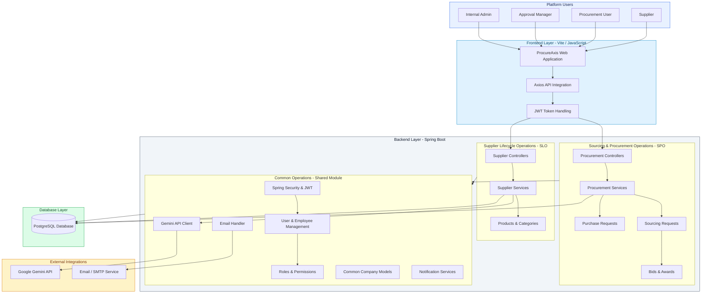

### 🔧 Architecture Components

- **Frontend:** Provides dedicated interfaces for procurement users, suppliers, approval managers, and internal administrators.
- **Supplier Lifecycle Operations (SLO):** Handles supplier onboarding, lifecycle management, products, product categories, and supplier-related operations.
- **Sourcing and Procurement Operations (SPO):** Handles purchase requests, sourcing activities, supplier invitations, bids, evaluations, and awards.
- **Common Operations:** Provides shared authentication, employee, role, permission, notification, email, and other common functionality.
- **PostgreSQL:** Provides persistent storage for application data.
- **Google Gemini API:** Supports AI-based supplier feedback generation through the Gemini client.

The modular design promotes separation of responsibilities, code reuse, and maintainability across business operations.

### 🔄 Service Interaction

1. Users interact with the application through the Vite frontend.
2. The frontend sends HTTP requests to the relevant backend service.
3. Spring Security validates authentication and authorization.
4. Controllers receive requests and delegate business operations to service classes.
5. Service classes execute business logic and interact with repositories.
6. Repositories use Spring Data JPA and Hibernate to access PostgreSQL.
7. SLO and SPO reuse shared functionality from Common Operations.
8. External integrations, such as Gemini and email services, are used by the relevant business workflows.

## 💻 Technology Stack

| Layer | Technology | Purpose |
|---|---|---|
| Frontend | HTML, CSS, JavaScript | User interface and application functionality |
| Frontend Tooling | Vite | Development server and production build |
| API Integration | Axios | HTTP communication with backend services |
| Backend | Java 17, Spring Boot 4.1.1 | REST API development and business logic |
| Security | Spring Security, JWT | Authentication and authorization |
| ORM | Spring Data JPA, Hibernate | Database interaction and persistence |
| Database | PostgreSQL | Relational data storage |
| Database Migration | Flyway | Version-controlled database migrations |
| AI Integration | Google Gemini API | AI-assisted supplier feedback |
| Build Management | Maven | Backend dependency and build management |
| API Testing | Postman | API testing and workflow validation |
| Database Administration | pgAdmin | Database inspection and management |

## 📁 Project Structure

The repository is organized into independent frontend and backend modules, along with screenshots, API testing resources, and deployment configurations.

```text
ProcureAxis/
│
├── screenshots/
│
├── fsc-frontend/
│   ├── src/
│   │   ├── api/
│   │   ├── assets/
│   │   └── pages/
│   ├── public/
│   ├── index.html
│   └── package.json
│
├── supply-chain-common-operations/
│   └── supply-chain-common-operations/
│       ├── src/
│       │   └── main/
│       │       ├── java/
│       │       └── resources/
│       ├── pom.xml
│       └── mvnw
│
├── supplier-lifecycle-operations/
│   ├── src/
│   │   └── main/
│   │       ├── java/
│   │       └── resources/
│   ├── pom.xml
│   └── mvnw
│
├── sourcing-and-procurement-operations/
│   ├── src/
│   │   └── main/
│   │       ├── java/
│   │       └── resources/
│   ├── pom.xml
│   └── mvnw
│
├── postman/
│   ├── FSC-API-Collection-Safe.json
│   └── sanitize-postman.js
│
├── Dockerfile
├── Dockerfile.spo
├── README.md
└── .gitignore
```

### 🗂️ Directory Responsibilities

- **screenshots:** Contains application screenshots used in the project documentation.
- **fsc-frontend:** Contains the web application, user interfaces, page components, and API integration.
- **supply-chain-common-operations:** Contains shared backend functionality consumed by the business modules.
- **supplier-lifecycle-operations:** Contains supplier onboarding and lifecycle management functionality.
- **sourcing-and-procurement-operations:** Contains procurement, sourcing, bidding, evaluation, and award functionality.
- **postman:** Contains the API collection and supporting sanitization script for API testing.
- **Dockerfiles:** Provide containerization configurations for backend deployment.

## ⚙️ Backend Architecture & Layers

The backend follows a layered architecture. Each layer has a defined responsibility, helping separate HTTP request handling, business logic, data transformation, and database operations.

### 🧱 Backend Request Flow

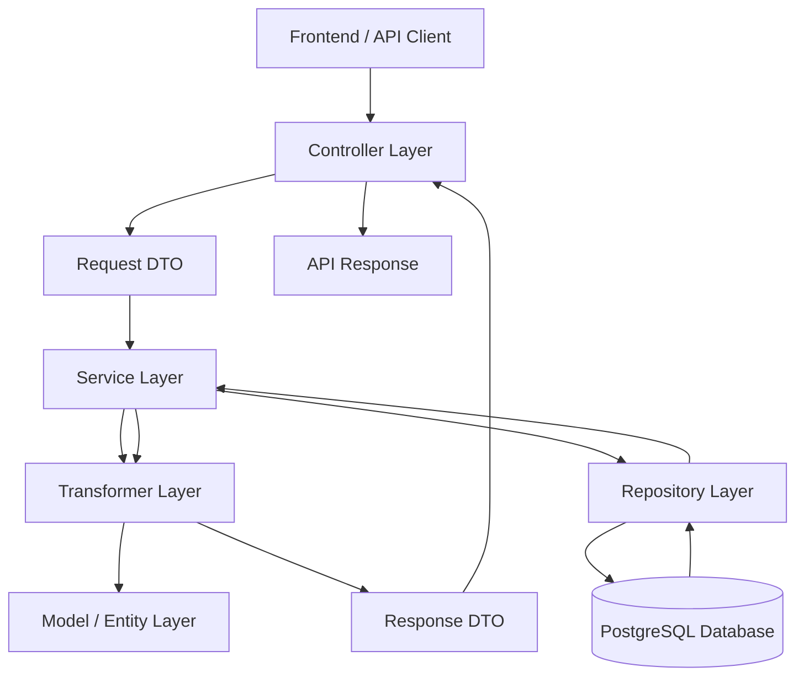

### 📦 Main Backend Layers

| Layer | Responsibility |
|---|---|
| Controllers | Expose REST endpoints and handle incoming HTTP requests. |
| DTOs | Define request and response data structures exchanged through APIs. |
| Services | Contain business logic and coordinate application operations. |
| Repositories | Perform database access through Spring Data JPA. |
| Transformers | Convert between request/response DTOs and application models. |
| Models / Entities | Represent business objects and database entities. |
| Security | Handle authentication, JWT validation, and authorization. |
| Clients | Integrate with external services and APIs. |
| Configuration | Defines application, security, and infrastructure configuration. |

### 🔁 How the Layers Work Together

1. A user performs an action in the frontend.
2. Axios sends the request to the relevant REST controller.
3. The controller receives the request and passes the required data to the service.
4. The service validates the request and applies business rules.
5. Transformers help convert between DTOs and model objects where required.
6. Repositories communicate with the database.
7. The service prepares the result and the controller returns the API response.

## ⚙️ Backend Modules

The backend is divided into three modules, each responsible for a distinct area of the supply chain management system.

### 1. 🔗 Common Operations

**Purpose:** A shared backend module that provides reusable services, security components, models, and repositories consumed by the business modules.

**Key Responsibilities:**
- JWT-based authentication and security configuration.
- Employee, user, and role management.
- Permission-based authorization.
- Shared company and business entities.
- Email and notification handling.
- Common repositories, services, and utilities.
- External API client integrations.

**Important Packages:**

| Package | Responsibility |
|---|---|
| `clients` | External API integrations, including the Gemini client. |
| `controllers` | Shared REST controller functionality. |
| `models` | Shared business entities such as User, Employee, Company, Role, and Notification. |
| `repositories` | Shared database access interfaces. |
| `services` | Authentication, employee, role, notification, email, and other shared business services. |
| `transformers` | Shared entity transformation functionality. |
| `securities` | Authentication, authorization, and security configuration. |

**Examples of shared components:**
- `AuthService`
- `EmployeeService`
- `RoleService`
- `NotificationService`
- `EmailHandlerImpl`
- `GeminiClient`
- `User`
- `Employee`
- `Company`
- `Role`
- `Notification`

### 2. 🏭 Supplier Lifecycle Operations (SLO)

**Purpose:** Responsible for supplier organization management and supplier-related business operations.

**Key Responsibilities:**
- Supplier company registration and management.
- Supplier account activation and lifecycle operations.
- Supplier approval, rejection, suspension, and deactivation.
- Product-category management.
- Product creation and management.
- AI-assisted supplier feedback generation.

**Important Packages:**

| Package | Responsibility |
|---|---|
| `controllers` | Supplier company, product, and product-category REST endpoints. |
| `services` | Supplier company, product, and product-category business logic. |
| `transformers` | Conversion between request/response DTOs and models. |
| `repositories` | Database operations through shared and module-specific repositories. |
| `models` | Supplier lifecycle domain models and inherited shared entities. |
| `dto` | Request and response data structures. |

**Examples of SLO components:**
- `SupplierCompanyController`
- `ProductController`
- `ProductCategoryController`
- `SupplierCompanyService`
- `ProductService`
- `ProductCategoryService`
- `ProductTransformer`
- `ProductCategoryTransformer`
- `RequestTransformer`

### 3. 🛒 Sourcing and Procurement Operations (SPO)

**Purpose:** Responsible for procurement processes and the end-to-end sourcing lifecycle.

**Key Responsibilities:**
- Procurement company registration and management.
- Purchase request creation, updates, and approval.
- Sourcing request creation and publication.
- Supplier invitation management.
- Bid creation and submission.
- Bid comparison and evaluation.
- Sourcing award management.

**Important Packages:**

| Package | Responsibility |
|---|---|
| `controllers` | REST endpoints for procurement and sourcing operations. |
| `services` | Procurement, purchase request, sourcing request, and bid business logic. |
| `repositories` | Database access for purchase requests, sourcing requests, invitations, and related records. |
| `models` | Shared and module-specific business entities. |
| `dto` | API request and response structures. |
| `transformers` | Data conversion where implemented. |

**Examples of SPO components:**
- `ProcurementCompanyService`
- `PurchaseRequestService`
- `SourcingRequestService`
- `BidService`
- `PurchaseRequestRepo`
- `SourcingRequestRepo`
- `SourcingSupplierInvitationRepo`

### 🔗 Module Integration

SLO and SPO reuse shared functionality from Common Operations.

This allows the application to maintain common authentication, user management, company information, notifications, and other reusable capabilities without duplicating the same business functionality across modules.

## 🤖 AI Integration – Google Gemini

ProcureAxis integrates Google's Gemini API to support AI-assisted supplier feedback generation.

### 🧠 AI Integration Architecture

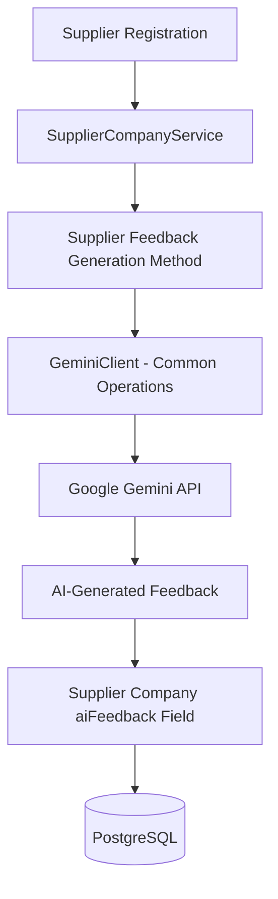

### 🔧 Implementation Components

| Component | Module | Responsibility |
|---|---|---|
| `SupplierCompanyService` | SLO | Initiates supplier feedback generation during supplier registration. |
| `getSupplierCompanyFeedback()` | SLO | Prepares the supplier analysis prompt and requests AI feedback. |
| `GeminiClient` | Common Operations | Communicates with the Google Gemini API. |
| `Company` model | Common Operations | Contains the `aiFeedback` field for storing feedback. |

### ✨ AI Feedback Capabilities

The supplier feedback prompt is designed to request constructive analysis covering:

- Supplier strengths.
- Potential weaknesses.
- Business and operational risks.
- Overall supplier assessment.
- Areas for improvement.

### 🔐 API Configuration

The Gemini API key is read through an environment variable:

```text
GEMINI_API_KEY
```

The API key must be configured in the environment where the SLO application runs.

**Security:** Never hardcode or commit the Gemini API key to the repository.

### 🛡️ Error Handling

Supplier feedback generation is protected by exception handling. If the Gemini API request fails, the application logs the failure and continues the supplier registration process.

AI feedback is an assistive feature and should not replace the platform's supplier approval and administrative decision-making workflows.

## 🖥️ Frontend Architecture

The ProcureAxis frontend is developed using HTML, CSS, and JavaScript, with Vite for development and build tooling and Axios for REST API communication.

The application provides dedicated, role-based portals to support different users across the procurement ecosystem.

### 🌐 Application Portals

**1. 🛒 Procurement Portal**
- Purchase request management.
- Sourcing request creation and tracking.
- Supplier invitation workflows.
- Bid comparison and award management.

**2. 🏭 Supplier Portal**
- Supplier dashboard and company profile.
- Product and product-category management.
- Sourcing opportunity discovery.
- Bid creation and submission.
- Notifications.

**3. ✅ Approval Manager Dashboard**
- Access to approval-related workflows.
- Management of assigned approval activities.

**4. 🛡️ Internal Admin Dashboard**
- Supplier company administration.
- Procurement company management.
- Supplier lifecycle actions.
- Internal administrative operations.

### 🔌 Frontend Integration

- Axios is used for communication with backend REST APIs.
- JWT tokens are used for authenticated API requests.
- Role-based navigation provides access to relevant application portals.
- Frontend pages interact with the SLO and SPO backend services.

## 🔄 Business Workflows

ProcureAxis supports structured business workflows that connect procurement organizations and suppliers throughout the procurement lifecycle.

### 1. 🏭 Supplier Onboarding Workflow

1. Supplier submits company registration details.
2. Supplier account activation is initiated.
3. Internal administrators review the supplier application.
4. The supplier is approved, rejected, or moved through the applicable lifecycle actions.
5. Approved suppliers can manage their products and participate in sourcing activities.
6. Supplier feedback generation can be initiated through the Gemini integration.

### 2. 🛒 Procurement Workflow

1. Procurement organization registers and activates its account.
2. Authorized employees create purchase requests.
3. Purchase requests proceed through the approval process.
4. Approved purchase requests are used to initiate sourcing requests.

### 3. 🔍 Sourcing and Bidding Workflow

1. Procurement creates a sourcing request from an approved purchase request.
2. Selected suppliers are invited to participate.
3. The sourcing request is approved and published.
4. Invited suppliers access the sourcing opportunity.
5. Suppliers submit their bids.
6. Procurement users compare and evaluate submitted bids.
7. The sourcing process proceeds to award management.

### 4. 👥 Employee and Access Management Workflow

1. Authorized users invite employees to their organization.
2. Invited employees activate their accounts.
3. Roles and permissions determine access to application functionality.
4. Manager assignments support organizational approval workflows.

## 🔐 Authentication & Authorization

ProcureAxis implements stateless, token-based authentication and role-based access control using Spring Security and JSON Web Tokens (JWT).

### 🛡️ Security Features

- **JWT Authentication:** Authenticated users receive a signed JWT after successful login.
- **Stateless Security:** Backend services use stateless session management.
- **Role-Based Access Control (RBAC):** Application access is controlled through assigned user roles.
- **Permission-Based Authorization:** Backend operations validate whether the authenticated user has the required permissions.
- **Account Validation:** User account activation and active status are checked during authentication.
- **Organization-Level Validation:** Internal administrative operations validate the employee's organization type and status.
- **Password Security:** Passwords are verified using Spring's password-encoding mechanism.
- **CORS Configuration:** Cross-origin requests are restricted to configured frontend origins.

### 🔁 Authentication Flow

1. User submits login credentials.
2. Backend validates the credentials and account status.
3. A signed JWT is generated after successful authentication.
4. The frontend uses the token for subsequent authenticated API requests.
5. Backend security filters validate the token and establish the user's authentication context.
6. Required roles and permissions are checked before protected operations are performed.

## 🔌 API Documentation & Testing

ProcureAxis provides RESTful APIs across its Common Operations, Supplier Lifecycle Operations (SLO), and Sourcing and Procurement Operations (SPO) modules.

**Postman** is used for API testing and end-to-end workflow validation.

### 📬 Postman Collection

The repository includes a Postman collection:

`postman/FSC-API-Collection-Safe.json`

The collection is organized into the following workflow groups:

- Authentication and Onboarding
- Company Approvals
- Product Catalogs
- Purchase Requests
- Sourcing
- Bids and Award

### 📋 API Coverage

| Module | API Operations |
|---|---|
| Common Operations | Login, employee activation, employee invitations and role management |
| SLO | Supplier registration, company approvals, product categories and product management |
| SPO | Procurement registration, purchase requests, sourcing requests, supplier invitations, bids, comparison and awards |

### 🌍 Local API Base URLs

| Service | Base URL |
|---|---|
| Supplier Lifecycle Operations | `http://localhost:8083` |
| Sourcing and Procurement Operations | `http://localhost:8081` |

### 🧪 Testing Approach

The Postman collection supports testing of the end-to-end business lifecycle, including:

1. Organization registration and account activation.
2. Authentication and authorized access.
3. Supplier and procurement company approvals.
4. Product and product-category management.
5. Purchase request creation and approval.
6. Sourcing request publication and supplier invitations.
7. Supplier bid submission and procurement-side bid comparison.
8. Sourcing award creation and retrieval.

The collection can be imported into Postman to execute and validate the API workflows.

## 🗄️ Database & Persistence

ProcureAxis uses **PostgreSQL** as its relational database to manage and persist application data across its business modules.

The backend uses Spring Data JPA and Hibernate for object-relational mapping (ORM), enabling interaction between Java entities and relational database tables.

### 🧰 Database Technologies

- **PostgreSQL:** Relational database for persistent application data.
- **Spring Data JPA:** Repository-based data access and database operations.
- **Hibernate:** ORM framework for entity mapping and persistence.
- **Flyway:** Database schema migration and version management.

### 📊 Main Database Entities

The shared domain model includes entities representing the main business areas of the platform.

| Entity / Model | Responsibility |
|---|---|
| `Company` | Common company information and shared company attributes. |
| `SupplierCompany` | Supplier organization information. |
| `ProcurementCompany` | Procurement organization information. |
| `User` | User account and authentication-related information. |
| `Employee` | Employee and organization membership information. |
| `Role` | Role information used for access management. |
| `Product` | Supplier product information. |
| `ProductCategory` | Product classification. |
| `PurchaseRequest` | Procurement purchase request information. |
| `PurchaseRequestLine` | Individual lines belonging to purchase requests. |
| `PurchaseRequestDecision` | Purchase request approval decision records. |
| `SourcingRequest` | Sourcing event information. |
| `SourcingRequestLine` | Individual sourcing request lines. |
| `SourcingRequestDecision` | Sourcing approval decision records. |
| `SourcingSupplierInvitation` | Supplier invitations for sourcing opportunities. |
| `Bid` | Supplier bid information. |
| `BidLine` | Individual bid line information. |
| `SourcingAward` | Sourcing award information. |
| `Notification` | Application notification records. |
| `NotificationTemplate` | Notification template information. |
| `Operation` | Shared operation and permission-related information. |

### 🔗 Database Relationship Overview

The database supports relationships across the procurement lifecycle:

- Companies are associated with their users and employees.
- Suppliers manage products and product categories.
- Procurement organizations create purchase requests and request lines.
- Purchase requests can be used to create sourcing requests.
- Sourcing requests contain sourcing lines and supplier invitations.
- Suppliers submit bids containing bid lines.
- Bid evaluation can lead to sourcing award records.
- Shared notification and operation records support platform workflows.

The exact foreign-key constraints and relationship cardinalities are defined by the application's entity mappings and database migrations.

### 📦 Persistence Responsibilities

The database supports the storage and management of:

- Supplier and procurement company information.
- Employee accounts, roles, and permissions.
- Products and product categories.
- Purchase requests and approval records.
- Sourcing requests and supplier invitations.
- Supplier bids and sourcing awards.
- Application-related operational records.
- AI-generated supplier feedback.

### 🛠️ Database Management

Database administration and inspection can be performed using **pgAdmin**.

Database credentials and connection settings should be maintained through environment-specific configuration rather than hardcoded in application source files.

## 📋 Prerequisites

Ensure the following tools and software are installed before setting up ProcureAxis locally.

| Requirement | Purpose |
|---|---|
| Java 17 | Backend application development and execution |
| Apache Maven | Backend dependency management and builds |
| Node.js | Frontend development environment |
| npm | Frontend dependency management |
| PostgreSQL | Relational database |
| pgAdmin | Database administration |
| IntelliJ IDEA | Backend development and execution |
| Postman | REST API testing |

### ⚙️ Recommended Setup

- Configure Java 17 as the active JDK.
- Ensure Maven is available in the system PATH.
- Use a Node.js version compatible with Vite 8.
- Create and configure the PostgreSQL database.
- Ensure the required backend modules can access the shared Common Operations dependency.

## 📥 Installation

Follow these steps to set up ProcureAxis in a local development environment.

### 1. 📂 Clone the Repository

```bash
git clone https://github.com/Isha0016/ProcureAxis.git
cd ProcureAxis
```

### 2. 🔗 Build Common Operations

Common Operations is a shared Maven dependency required by both SLO and SPO.

Navigate to its Maven project directory:

```bash
cd supply-chain-common-operations/supply-chain-common-operations
mvn clean install
```

This builds and installs the shared module into the local Maven repository.

### 3. 🏭 Build Supplier Lifecycle Operations

Navigate to the SLO module:

```bash
cd ../../supplier-lifecycle-operations
mvn clean install
```

### 4. 🛒 Build Sourcing and Procurement Operations

Navigate to the SPO module:

```bash
cd ../sourcing-and-procurement-operations
mvn clean install
```

### 5. 🖥️ Install Frontend Dependencies

Navigate to the frontend directory:

```bash
cd ../fsc-frontend
npm install
```

After completing these steps, the backend modules and frontend dependencies are ready for local configuration and execution.

## ⚙️ Environment Configuration

Before running the application, configure the required environment-specific properties for each backend module.

### 📄 Backend Configuration Files

| Module | Configuration File |
|---|---|
| Common Operations | `supply-chain-common-operations/supply-chain-common-operations/src/main/resources/application.properties` |
| Supplier Lifecycle Operations | `supplier-lifecycle-operations/src/main/resources/application.properties` |
| Sourcing and Procurement Operations | `sourcing-and-procurement-operations/src/main/resources/application.properties` |

### 🔧 Required Configuration

Ensure the following settings are configured correctly:

- **Database Connection:** PostgreSQL URL, username, and password.
- **JWT Security:** Token signing secret and related authentication settings.
- **Email Service:** SMTP host, port, sender details, and credentials.
- **Application Ports:** Configure the appropriate port for each backend service.
- **Frontend API URLs:** Configure the frontend to communicate with the correct backend endpoints.
- **Gemini API:** Configure `GEMINI_API_KEY` for AI-assisted supplier feedback generation.

### 🔒 Security Considerations

- Do not commit database passwords, JWT secrets, SMTP credentials, or API keys to GitHub.
- Use environment variables or deployment-specific secrets for sensitive configuration.
- Maintain separate configurations for local development and production environments.
- Never publish real credentials in documentation or configuration examples.

## 🚀 Running the Application

Start the backend services and frontend independently during local development.

### 1. 🏭 Start Supplier Lifecycle Operations (SLO)

Navigate to the SLO directory and execute:

```bash
mvn spring-boot:run
```

**Default Port:** `8083`

### 2. 🛒 Start Sourcing and Procurement Operations (SPO)

Open a separate terminal, navigate to the SPO directory, and execute:

```bash
mvn spring-boot:run
```

**Default Port:** `8081`

### 3. 🖥️ Start the Frontend

Open another terminal and navigate to the frontend directory:

```bash
npm run dev
```

Vite starts the frontend development server. Open the local URL displayed in the terminal, typically:

```text
http://localhost:5173
```

### 🌐 Service Endpoints

| Component | Local Address |
|---|---|
| Frontend | `http://localhost:5173` |
| Supplier Lifecycle Operations | `http://localhost:8083` |
| Sourcing and Procurement Operations | `http://localhost:8081` |

**Note:** Common Operations is a shared backend dependency used by SLO and SPO. It is not started as a separate application.

Ensure PostgreSQL is running and the required database and environment configurations are available before starting the backend services.

## ☁️ Deployment

ProcureAxis supports deployment of its frontend and backend components as separate application services.

### 🏗️ Deployment Architecture

| Component | Deployment Platform |
|---|---|
| Frontend | Vercel |
| Backend Services | Railway |
| Database | PostgreSQL |

### ⚙️ Deployment Considerations

- Configure frontend and backend environment variables for the production environment.
- Update frontend API base URLs to point to the deployed backend services.
- Configure production database connection properties.
- Secure JWT signing secrets, email credentials, and Gemini API keys using deployment environment variables.
- Configure CORS to allow requests from the deployed frontend domain.
- Verify database migrations and service connectivity before releasing updates.

### ✅ Production Readiness

Before deployment, ensure that:

- All backend modules build successfully.
- Frontend production build completes successfully.
- Database connectivity and migrations are verified.
- Authentication and authorization work correctly.
- API endpoints are accessible from the deployed frontend.
- Gemini API configuration is available to the SLO service.
- Sensitive configuration values are not exposed in the repository.

## 📸 Application Screenshots

The following screenshots showcase the ProcureAxis user interface and its key application modules. All images are stored in the root-level `screenshots/` directory.

### 1. 🏠 Landing Page

<table>
  <tr>
    <td width="50%">
      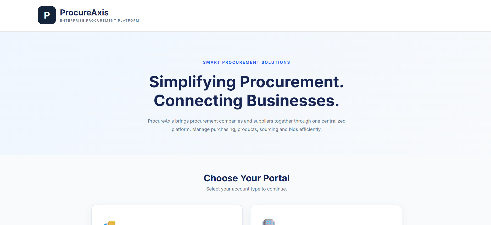
    </td>
    <td width="50%">
      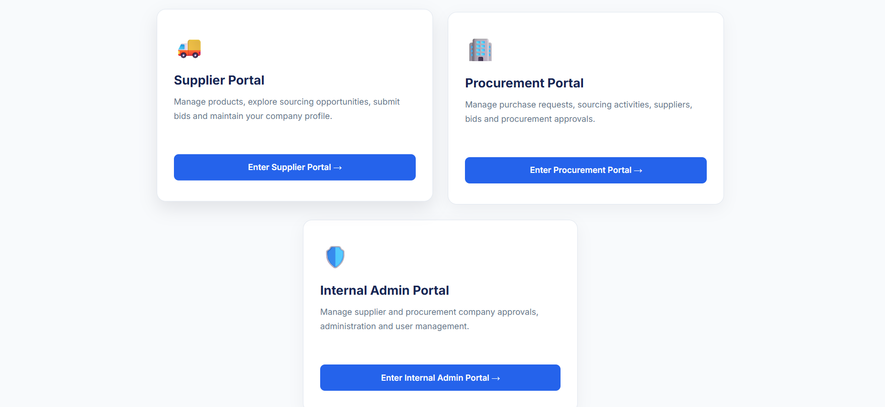
    </td>
  </tr>
</table>

### 2. 🛒 Procurement Portal

<table>
  <tr>
    <td width="50%">
      
    </td>
    <td width="50%">
      
    </td>
  </tr>
</table>

### 3. 🏭 Supplier Portal

<table>
  <tr>
    <td width="50%">
      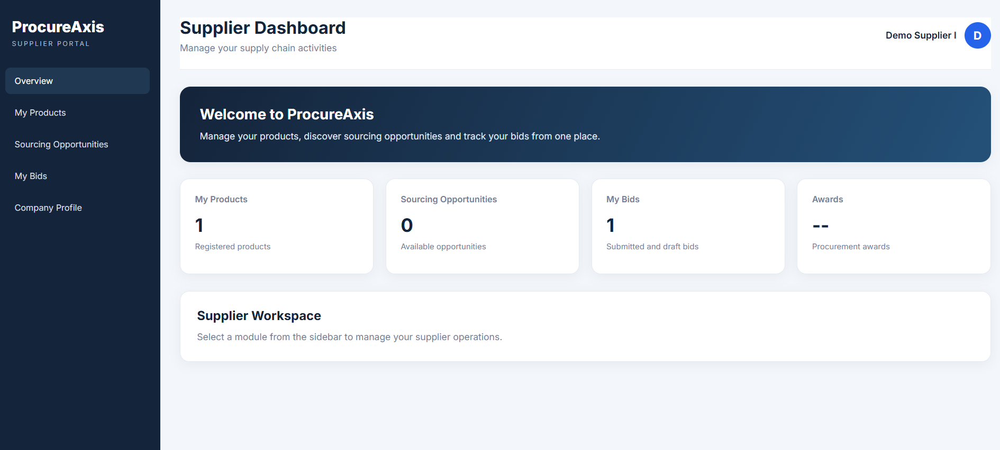
    </td>
    <td width="50%">
      
    </td>
  </tr>
  <tr>
    <td width="50%">
      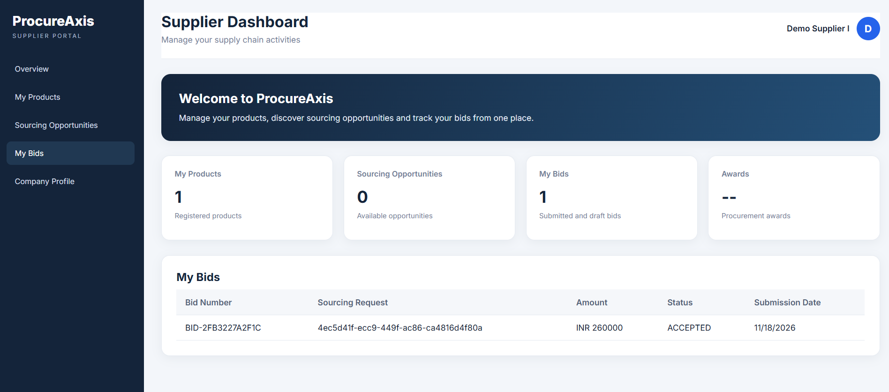
    </td>
    <td width="50%">
      
    </td>
  </tr>
</table>

### 4. ✅ Approval Manager Dashboard

<p align="center">
  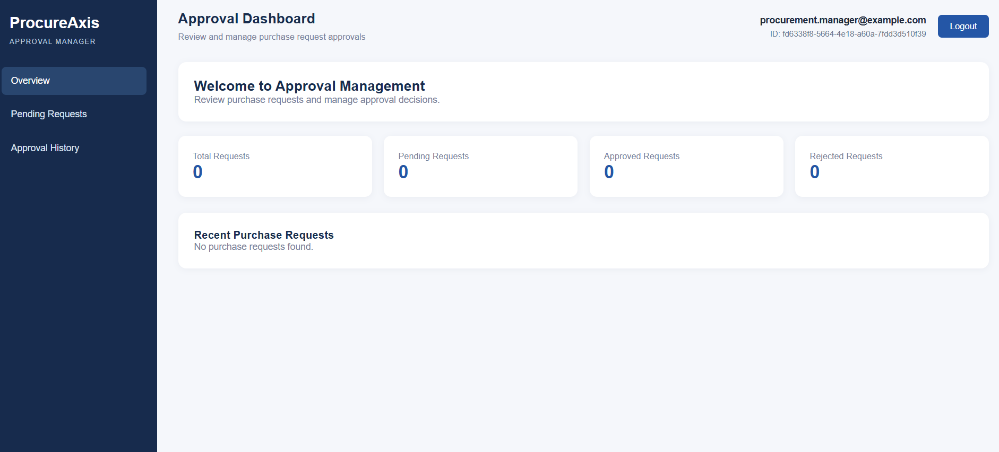
</p>

### 5. 🛡️ Internal Admin Dashboard

<table>
  <tr>
    <td width="50%">
      
    </td>
    <td width="50%">
      
    </td>
  </tr>
  <tr>
    <td width="50%">
      
    </td>
    <td width="50%">
      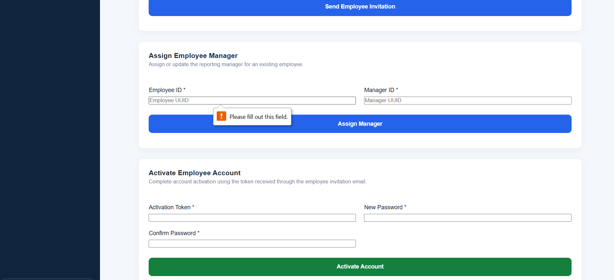
    </td>
  </tr>
</table>

<p align="center">
  
</p>

### 6. 📝 Supplier Registration

<p align="center">
  
</p>

### 7. 📊 Sourcing & Bid Management

<table>
  <tr>
    <td width="50%">
      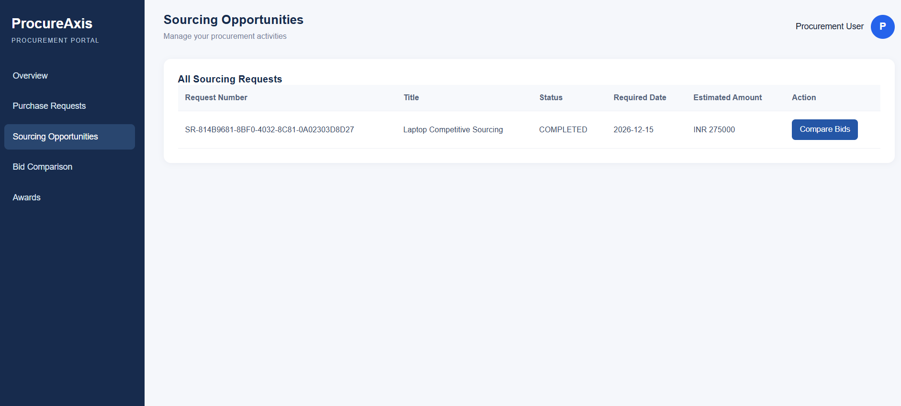
    </td>
    <td width="50%">
      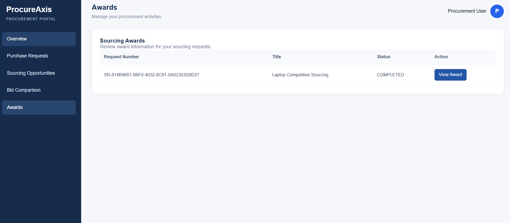
    </td>
  </tr>
</table>

### 8. 📧 Email Notifications

<p align="center">
  
</p>

## 🔮 Future Enhancements

- **Advanced Analytics & Reporting:** Interactive dashboards for procurement performance, supplier evaluation, and spending insights.
- **Automated Workflows:** Enhanced approval workflows and automated procurement notifications.
- **Document Management:** Centralized storage and management of procurement-related documents.
- **Enhanced Supplier Insights:** Supplier performance tracking and evaluation metrics.
- **Scalability:** Further improvements to support larger organizations and higher transaction volumes.

## 🤝 Contributing

Contributions, suggestions, and improvements are welcome.

If you would like to contribute:

1. Fork the repository.
2. Create a new feature branch.
3. Make your changes and test them.
4. Commit your changes with a descriptive message.
5. Submit a Pull Request for review.

## 👨‍💻 Author & Project Information

**Developed by:** Isha

**Project:** ProcureAxis – Enterprise Procurement & Supply Management System

**Live Application:** [Visit ProcureAxis](https://procure-axis.vercel.app/)

**GitHub Profile:** [View Profile](https://github.com/Isha0016)

**Source Code:** [ProcureAxis Repository](https://github.com/Isha0016/ProcureAxis.git)

---

⭐ If you find this project interesting, consider giving the repository a star!